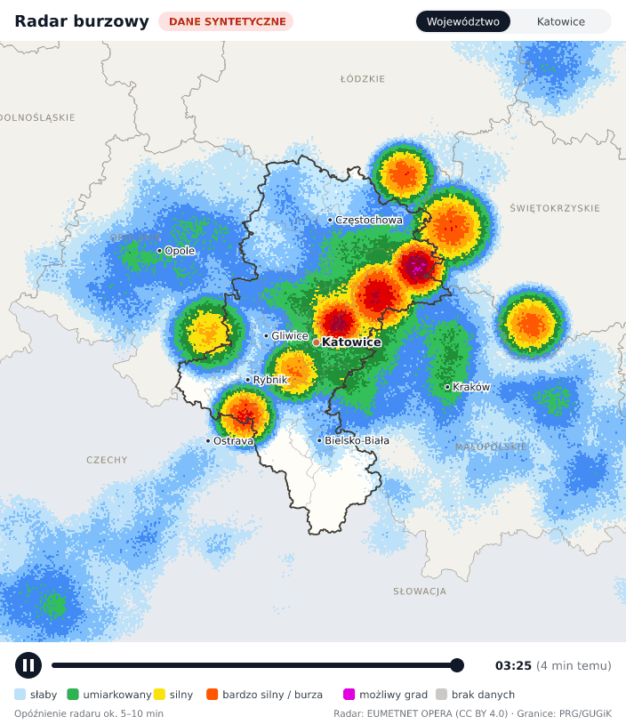
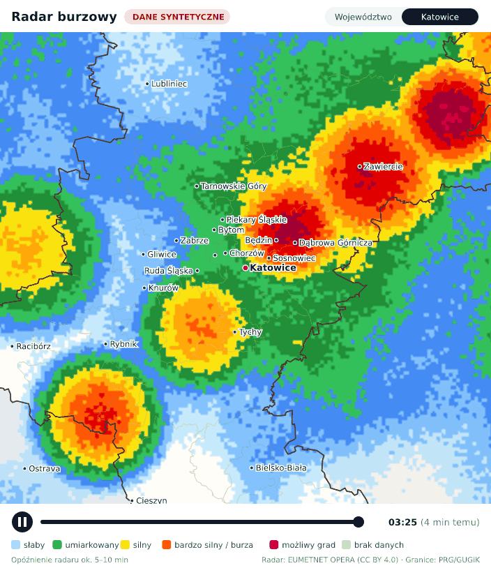

# Radar burzowy w `<mo-weather>`: plan wdrożenia

> Stan na **2026-10-16**. Dane źródłowe sprawdziłem na żywo 15.10.2026 (A.2, C.2), PoC opisuje C.10.
> Część **A** jest dla właściciela projektu i nie wymaga wiedzy technicznej. Części **B–D** są dla programisty.

## Status: MVP zaimplementowany (B.1–B.3), czeka na wdrożenie (B.4)

**Co jest w repozytorium:**
- `src/radar-lib.php`: dekoder COG, LUT, PNG, cykl producenta;
- `scripts/radar-worker.php`: producent;
- `src/radar-api.php`: endpoint `/api/radar`;
- `src/mo-radar.js` + `src/mo-radar-basemap.js`: okno radaru, budowane do `dist/mo-radar.min.js`;
- w `src/weather-widget.js`: przycisk i ładowanie modułu po kliknięciu;
- testy w `tests/radar.test.php` i `tests/widget.test.js` (19–22).

**Sprawdzone lokalnie:**
- **Dekoder.** Mini-plik COG z GDAL (`tests/fixtures/`) daje siatkę klas identyczną co do piksela z dokładnym przeliczeniem PROJ.
- **Worker.** Na 13 syntetycznych plikach OPERA: 13 klatek, ok. 0,45 s na klatkę w PHP/WASM, PNG ok. 30 KB.
- **Endpoint.**
  - Działają ETag i 304, nagłówki cache, CORS z allowlisty.
  - Zwraca 404 dla obcych `frame` i 405 dla POST.
  - W `type=health` jest sekcja `radar`.
- **Przeglądarka (Chrome 138, 23 sprawdzenia).**
  - Przycisk pojawia się tylko z atrybutem `radar`, a moduł ładuje się dopiero po kliknięciu.
  - Działają animacja, widok miasta, Esc z powrotem fokusu, tryby floating i aggregator, `prefers-reduced-motion`.
  - Stany błąd / `down` / `stale` są obsłużone, napisy czytelne na telefonie.
  - axe-core nie zgłasza błędów WCAG w oknie radaru.
  - CLS 0: skeleton rośnie o wysokość przycisku.

**Rozmiary:**
- główny bundle 23 568 B (limit 25 000 B; wcześniej 20 625 B);
- `mo-radar.min.js` 53 KB (19 KB po gzip, limit 60 KB);
- podkład 40 KB (tolerancja uproszczenia 0,6 px).

**Nadal niesprawdzone:** prawdziwa klatka OPERA, bo z mojego środowiska nie ma dostępu do S3 CloudFerro. Sprawdza ją krok 2 checklisty B.4: po deployu `/api/radar?manifest` ma pokazać `status: fresh`.

**Odstępstwa od planu (świadome):**
1. **Bez `src/mo-lib.php`.** Portale z lokalnym proxy kopiują tylko `weather-api.php` i `cities.php`; nowy wymagany plik by je zepsuł. Zamiast tego `radar-api.php` i worker definiują `MO_LIB_ONLY` i dołączają `weather-api.php` dla `mo_cors`, `mo_json`, `mo_cache_dir`.
2. **Moduł jako zwykły skrypt (`<script>`), nie `import()`.** Import modułu ES z innej domeny wymaga CORS na plikach statycznych, a wbudowany serwer PHP go nie wysyła. Adres modułu to plik obok skryptu widgetu (`weather-widget.min.js` → `mo-radar.min.js`), atrybut `radar-src` go nadpisuje.
3. **Bez rate limitu na `/api/radar`.** Jedno otwarcie mapy to 14 zapytań, a odpowiedzi to gotowe pliki z dysku, bez zapytań do źródła. Limit 30/min blokowałby czytelników bez korzyści.
4. **`?frame=T` serwuje każdą istniejącą klatkę** (wyrażenie regularne, prawdziwa data, plik na dysku), nie tylko te z manifestu. Bez wyścigu z rotacją manifestu.
5. **Manifest:** `frames: [{t}]`, `latest`, `bbox_ll`, `size`, `step_seconds` (URL klatki składa klient). Kontrakt jest w `docs/SPEC.md` §4.7.
6. **Klatka jako SVG `<image>`, powiększenie przez `viewBox`** (nie CSS `transform`). Granice rysują się nad radarem, a napisy mają stały rozmiar na ekranie.
7. **Wersja zostaje 2.0.0.** Testy przypinają ją w nagłówkach i w `type=health`; wyrównanie z CHANGELOG to osobny temat.
8. **Domyślny widok to województwo** z wyróżnionym miastem czytelnika (burze nadciągają z daleka), przycisk z nazwą miasta przybliża.

---

## A. Najważniejsze w 3 minuty

### A.1 Co dostaniecie

- W widgecie pojawia się przycisk **„Radar burzowy”**.
- Po kliknięciu otwiera się okno z mapą **województwa śląskiego** albo **zbliżeniem na miasto czytelnika**. Mapa pokazuje animację opadów i burz z **ostatniej godziny**, z klatką co 5 minut.
- W oknie jest legenda (od „słaby deszcz” do „możliwy grad”), godzina klatki i dopisek „8 min temu”.
- Działa na wszystkich 12 portalach. Bez kluczy API, bez opłat, bez cookies i bez zewnętrznych dostawców map.
- Później, jeśli zechcecie, można dołożyć pioruny z satelity, strzałki wiatru i ostrzeżenia IMGW na mapie powiatów. Każdą z tych opcji osobno.

Czego to **nie** będzie:
- prognozy „za godzinę” (pokazujemy tylko obserwacje);
- widoku ulic (radar ma rozdzielczość 1 km);
- pojedynczych uderzeń piorunów.

### A.2 Czy to zadziała? Tak, sprawdziłem na prawdziwych danych

| Pytanie | Wynik | Jak sprawdzone (15.10.2026, czas UTC) |
|---|---|---|
| Czy dane są darmowe i wolno je pokazywać na portalach z reklamami? | **Tak.** Licencja CC BY 4.0; wystarczy podpis „EUMETNET OPERA”. Licencja jest wpisana w sam plik z danymi. | metadane plików z 12:00 i 23:50 |
| Czy nad Śląskiem są polskie radary? | **Tak, wszystkie 10.** Są m.in. Ramża (25 km od Katowic), Góra Św. Anny i Brzuchania, a do tego radary czeskie i słowackie. Śląsk ma bardzo gęste pokrycie: jeden radar stoi w samym województwie, dwa tuż obok. | lista radarów (`nodes`) w plikach z 12:00 i 23:50 |
| Jak świeże są dane? | Nowa klatka co 5 min, bez przerw. Plik pojawia się ok. **4 min** po czasie pomiaru, więc czytelnik widzi obraz sprzed ok. 5–10 min. | 11 kolejnych klatek z 23:00–23:50 |
| Czy da się ten plik odczytać prostym kodem? | **Tak.** To najprostszy wariant formatu: standardowy plik GeoTIFF (COG), zwykła kompresja, bez dodatkowego kodowania. Z każdej klatki pobieramy tylko 4 z 72 kafli, czyli szacunkowo 0,2–0,4 MB z 3,4 MB. | nagłówek pliku z 23:50 rozkodowany pole po polu |
| Pioruny (opcja) | Warstwa EUMETSAT działa. Nowe dane co 5 min, opóźnienie ok. 15 min. | zapytanie o 23:56 |
| Wiatr (opcja) | MET Norway, już używany w widgecie, zwraca kierunek i prędkość wiatru. | zapytanie o 23:56 |
| Ostrzeżenia IMGW (opcja) | Działają. Kody powiatów śląskich są w danych: tej nocy ostrzeżenie przed mgłą obejmowało m.in. powiaty 2401, 2404, 2416 i Dąbrowę Górniczą (2465). | zapytanie o 23:56 |
| Czy nasz kod w PHP poprawnie maluje radar na mapie? | **Tak.** Dekoder w czystym PHP odczytał pliki o identycznej budowie jak OPERA (zapisane tym samym narzędziem, GDAL). Wynik: 13 klatek, 6,19 mln pikseli, **100% zgodności** z dokładnym przeliczeniem wzorcowej biblioteki PROJ. Klatka nakłada się na mapę województwa 1:1 (C.10). | PoC 16.10.2026, dane syntetyczne |

**Czego jeszcze nie sprawdziłem:** przepuszczenia prawdziwej klatki przez nasz dekoder, bo z mojego środowiska nie ma dostępu do serwera z danymi. Ryzyko jest małe: format prawdziwego pliku znamy co do bajtu, a pliki testowe mają identyczną budowę. Zrobi to jedno polecenie (`php scripts/radar-poc/render-frame.php --latest`) przy pierwszym wdrożeniu albo test w GitHub Actions (C.9). Czytelnicy zobaczą przycisk dopiero wtedy, gdy obraz będzie dobry (B.4).

### A.3 Ile to kosztuje

| Pozycja | Koszt |
|---|---|
| Dane radarowe | **0 zł** (CC BY 4.0) |
| Serwer | Obecny Railway, bez nowych usług. Ok. 1 s pracy procesora co 5 min, kilka MB dysku, ok. 50–120 MB pobranych danych na dobę. |
| Transfer do czytelników | Ok. 100–300 KB na jedno otwarcie mapy. Klatki zostają w pamięci podręcznej przeglądarki. |
| Praca | Pierwsza wersja (sam radar): **4–5 dni** programisty, bo dekoder, generator mapy i prototyp okna już są (C.10). Każda opcja (pioruny, wiatr, ostrzeżenia) to 0,5–1 dnia. |
| Utrzymanie | Praktycznie zero. Wyjątek: reakcja na alert, gdyby EUMETNET zmienił format pliku (A.5). |

### A.4 Decyzje, które podjąłem za Ciebie

Nie musisz niczego wybierać. Jeśli z czymś się nie zgadzasz, daj znać.

| Decyzja | Wybór | Dlaczego |
|---|---|---|
| Czym przetwarzamy dane | **Czyste PHP**, bez GDAL | Format pliku okazał się najprostszy z możliwych, więc dekoder to ok. 300 linii PHP. Do tego:<br>• obraz Dockera się nie zmienia;<br>• testy działają w obecnym CI;<br>• zgodne z zasadami repo (CONTRIBUTING §1).<br>GDAL zostaje jako plan B (C.7). |
| Mapa | **Własny, lekki podkład SVG** (granice powiatów i miasta) | Nie ma zewnętrznego dostawcy map, więc nie ma opłat, cookies ani tematu RODO. Działa też przy restrykcyjnym CSP portali. Przy rozdzielczości radaru 1 km ulice i tak niewiele dają. |
| Gdzie powstają klatki | **Jeden centralny proces** na Railway (`api.mediaoperator.pl`) | Jedno pobranie danych na 5 min, bez względu na ruch. Portale tylko wyświetlają gotowe obrazki. |
| Portale z własnym proxy (np. slazag.pl) | Też biorą radar z centralnego API | Lista dozwolonych domen (CORS) już obejmuje wszystkie 13 domen. Kopia lokalna (tryb `mirror`) tylko wtedy, gdyby któryś portal jej wymagał. |
| Historia animacji | 1 godzina (13 klatek) | Wystarcza, żeby zobaczyć, w którą stronę idzie burza, przy mniejszej ilości danych. |
| Zakres pierwszej wersji | **Tylko radar** | Najkrótsza droga do działającego efektu. Opcje dokładamy później, każdą osobno. |
| Mail do IMGW | **Niepotrzebny w pierwszej wersji** | Radar pochodzi z OPERA, nie z IMGW. Ostrzeżenia IMGW to dane HVD (wolno ich używać komercyjnie); mail warto wysłać dopiero przy tej opcji. |

### A.5 Ryzyka

| Ryzyko | Co się stanie | Co robimy |
|---|---|---|
| EUMETNET zmieni format albo adresy plików | Radar przestaje się aktualizować. Reszta widgetu działa normalnie. | Kod sprawdza format każdej klatki i przy zmianie zgłasza błąd, zamiast rysować bzdury. W oknie radaru pojawia się „Radar chwilowo niedostępny”. Poprawka zajmuje ok. 0,5 dnia; alternatywnie przechodzimy na plan B (GDAL). |
| Awaria jednego radaru (np. Ramży) | Słabsze pokrycie fragmentu mapy | Obszar bez danych rysujemy na szaro jako „brak danych”, a nie jako „brak deszczu”. Sąsiednie radary częściowo go pokrywają. |
| Skok ruchu w czasie burzy | Więcej zapytań o obrazki | Obrazki się nie zmieniają, więc przeglądarki i ewentualny CDN trzymają je w cache. Produkcja klatek nie zależy od ruchu. |
| Restart serwera na Railway | Przez ok. 20 s po restarcie nie ma historii | Proces sam dociąga ostatnią godzinę; dane leżą w źródle 24 h. |
| Opóźnienie 5–10 min | Obraz jest „sprzed chwili” | Zawsze pokazujemy godzinę klatki. |

### A.6 Czego potrzebuję od Ciebie

1. Napisz **„robimy”**, a zacznę implementację na tej gałęzi (etapy B.1–B.3).
2. Przy wdrożeniu ktoś z dostępem do Railway ustawia jedną zmienną (`MO_RADAR_MODE=producer`) i robi deploy. Pełna checklista jest w B.4.
3. Na portalach trzeba dopisać atrybut `radar` w szablonie widgetu. Portale, które trzymają pliki JS u siebie (np. slazag.pl), wgrywają 2 pliki zamiast 1.

---

## B. Plan wdrożenia krok po kroku

Każdy etap kończy się działającym i przetestowanym stanem. Kolejność jest celowa: backend pracuje w tle, zanim czytelnicy zobaczą przycisk.

### B.1 Producent klatek w czystym PHP (ok. 1,5–2 dni)

Punkty 2–4 są już zrobione w PoC (`scripts/radar-poc/render-frame.php`). Zostaje przeniesienie ich do `src/radar-lib.php` z testami.

| # | Zadanie | Pliki |
|---|---|---|
| 1 | Przenieść wspólne helpery z `weather-api.php` (`mo_cors`, `mo_json`, `mo_cache_dir`, `mo_http_get`, `mo_rate_limit`) do `src/mo-lib.php`. Refaktor bez zmiany zachowania; obecne testy muszą przechodzić. | `src/mo-lib.php`, `src/weather-api.php` |
| 2 | Czytnik COG:<br>• nagłówek TIFF i IFD0 (pierwsze 64 KB przez `Range`);<br>• walidacja formatu (C.3);<br>• 4 kafle przez `Range`, rozpakowanie `gzuncompress`;<br>• odczyt pasma 1 przez `unpack('g', …)`. | `src/radar-lib.php` |
| 3 | Tablica przeliczeń (LUT): dla każdego z 704×676 pikseli wyjściowych indeks piksela OPERA (Web Mercator → lon/lat → LAEA). Liczona raz i zapisywana w cache z kluczem geotransform + bbox + rozmiar. | `src/radar-lib.php` |
| 4 | Paleta dBZ (C.3) i koder PNG z paletą (`gzcompress` + `crc32`, ok. 40 linii). | `src/radar-lib.php` |
| 5 | Worker:<br>• listing S3 (bieżąca i poprzednia godzina);<br>• brakujące klatki z ostatnich 60 min: render, zapis atomowy;<br>• `manifest.json`, kasowanie klatek starszych niż 2 h;<br>• statystyka `nodata`;<br>• blokada `flock` (jedna instancja naraz). | `scripts/radar-worker.php` |
| 6 | Endpoint `/api/radar` (C.4): `?manifest` i `?frame=…`, CORS z tej samej allowlisty, nagłówki cache, walidacja parametru `t`. | `src/radar-api.php`, `router.php`, `public/api/radar.php`, `scripts/build.sh` |
| 7 | Uruchamianie: pętla workera w `Dockerfile`, włączana zmienną `MO_RADAR_MODE=producer` (C.6). Odpowiedź `type=health` dostaje sekcję `radar`. | `Dockerfile`, `src/weather-api.php` |
| 8 | Testy PHP:<br>• punkty referencyjne LAEA (C.3);<br>• mały syntetyczny TIFF o tej samej budowie co plik OPERA;<br>• koder PNG (poprawne CRC, rozpakowany IDAT równy wejściu);<br>• walidacja parametrów API.<br>Podpięte pod `npm test`, więc obecne CI je uruchomi. | `tests/radar.test.php`, `tests/fixtures/`, `package.json` |

**Gotowe, gdy:**
- `php scripts/radar-worker.php --once` tworzy 13 klatek z prawdziwych danych;
- `GET /api/radar?manifest` zwraca `status: fresh`;
- klatka nad Śląskiem pokazuje echo zgodne z meteo.imgw.pl z tej samej godziny;
- PNG ma nie więcej niż 50 KB;
- testy przechodzą.

### B.2 Okno radaru w widgecie (ok. 1,5 dnia)

Gotowe w PoC:
- generator mapy (`scripts/gen-basemap.mjs`);
- prototyp okna (`scripts/radar-poc/demo/index.html`).

Zostaje przeniesienie prototypu do shadow DOM widgetu i ładowanie leniwe.

| # | Zadanie | Pliki |
|---|---|---|
| 1 | Atrybuty `radar` (włącza przycisk) i `radar-url` (domyślnie centralne API). Przycisk „Radar burzowy” w stopce karty i w panelu floating. Kliknięcie robi `import()` modułu `mo-radar.min.js` z katalogu skryptu widgetu (`document.currentScript.src`, awaryjnie atrybut `radar-src`). Przed kliknięciem nie ma żadnego ruchu sieciowego. | `src/weather-widget.js` |
| 2 | Generator podkładu:<br>• źródło: powiaty z `polska-geojson` (MIT, dane PRG);<br>• rzut Web Mercator na ten sam bbox co klatki;<br>• uproszczenie linii i etykiety miast;<br>• wynik wstawiany do `src/mo-radar.js` razem z tabelą pozycji 14 miast. | `scripts/gen-basemap.mjs` |
| 3 | Moduł `mo-radar`:<br>• `<dialog>` w shadow root;<br>• widoki „Moje miasto” i „Województwo”;<br>• odtwarzacz: play/pause, suwak, godzina w strefie Europe/Warsaw, „x min temu”;<br>• legenda i atrybucja;<br>• stany `stale` i `down`;<br>• zamykanie Esc, obsługa fokusu, `prefers-reduced-motion`.<br>Tylko `textContent` i DOM API (CONTRIBUTING §3). | `src/mo-radar.js` |
| 4 | Testy JS:<br>• przycisk pojawia się tylko z atrybutem `radar`;<br>• budżet głównego bundla bez zmian (dziś 20 625 B przy limicie 25 000 B);<br>• budżet `mo-radar.min.js` z podkładem: do 60 KB. | `tests/widget.test.js`, `scripts/build.sh` |

**Gotowe, gdy:**
- na stronie demo (`public/index.html`) przycisk otwiera okno;
- animacja gra, przełączanie widoków działa;
- audyt dostępności nie zgłasza nowych błędów;
- CLS = 0.

### B.3 Dokumentacja i porządki (ok. 0,5 dnia)

- `docs/INTEGRATION.md`: atrybut `radar`, dwa pliki JS przy hostingu lokalnym, CSP (`img-src` i `connect-src` dla `api.mediaoperator.pl`).
- `docs/SECURITY.md`: nowy endpoint i jego walidacja.
- `docs/MAINTENANCE.md`: co robić przy statusie `down`.
- `README.md`, `CHANGELOG.md`.
- Wyrównać numer wersji: w `package.json` jest 2.0.0, a w CHANGELOG 2.1.0.

### B.4 Wdrożenie bez ryzyka (ok. 0,5 dnia, checklista)

1. Merge PR. Na Railway ustawić `MO_RADAR_MODE=producer` i zrobić deploy.
2. Po 2 minutach otworzyć `https://api.mediaoperator.pl/api/radar?manifest`. Ma być `status: fresh` i 13 klatek. Otworzyć ostatnią klatkę i porównać ją z meteo.imgw.pl.
3. Przez dobę obserwować `type=health` (sekcja `radar`). Czytelnicy nadal niczego nie widzą.
4. Włączyć przycisk na jednym portalu (atrybut `radar` w szablonie). Sprawdzić na telefonie i na komputerze.
5. Włączyć na pozostałych portalach:
   - portale z lokalnymi plikami JS (slazag.pl) wgrywają `weather-widget.min.js` i `mo-radar.min.js`;
   - jeśli portal ma CSP, trzeba dopisać `api.mediaoperator.pl` do `img-src` i `connect-src`.
6. Wycofanie w razie problemu: usunąć atrybut `radar` z szablonu (przycisk znika) albo ustawić `MO_RADAR_MODE=off`.

### B.5 Opcje na później (każda osobno)

| Opcja | Nakład | Źródło (sprawdzone 15.10.2026) |
|---|---|---|
| Ostrzeżenia IMGW na mapie powiatów i plakietka w karcie | 0,5–1 dnia | IMGW `warningsmeteo` (HVD; komercyjnie OK z atrybucją) |
| Strzałki wiatru (ok. 10 punktów i 14 miast) | 0,5–1 dnia | MET Norway (CC BY 4.0), już używany |
| Pioruny z satelity | ok. 1 dnia | EUMETSAT MTG LI, warstwa `mtg_fd:li_afa` (CC BY 4.0) |
| „Burza w okolicy” w karcie, bez otwierania mapy | ok. 0,5 dnia | te same dane radaru |
| Lokalna kopia klatek dla portalu (tryb `mirror`) | ok. 0,5 dnia | tylko jeśli portal wymaga jednego originu |

---

## C. Szczegóły techniczne

### C.1 Architektura

```
OPERA S3 (Warszawa, CC BY 4.0) ── listing + Range GET 4 kafli, co 5 min
            │
            ▼
Railway / api.mediaoperator.pl  (jeden kontener, jak dziś)
  ├─ php -S … router.php               ← obecne API pogody, bez zmian
  └─ pętla: php scripts/radar-worker.php --once; sleep 60    (MO_RADAR_MODE=producer)
        → /tmp/mo-cache/radar/: radar_YYYYMMDDTHHMM.png, manifest.json, lut-*.bin
            │
            ▼
  /api/radar?manifest        JSON, max-age=60, ETag
  /api/radar?frame=…         PNG, max-age=86400, immutable
            │
            ▼
12 portali: <mo-weather radar> → [Radar burzowy] → import mo-radar.min.js → <dialog>
            manifest przez CORS (allowlista 13 domen już jest), klatki jako 
```

Zasada: **zapytania czytelników nigdy nie przetwarzają danych.** Robi to wyłącznie proces w tle. Jeśli manifest jest starszy niż 15 min, API oddaje go ze statusem `stale`.

### C.2 Dane OPERA: zweryfikowany format

**Pliki**
- Adres: `https://s3.waw3-1.cloudferro.com/openradar-24h/YYYY/MM/DD/OPERA/COMP/OPERA@YYYYMMDDTHHMM@0@DBZH.tiff`, ok. 3,4 MB.
- Obok leżą `.h5` (ODIM) oraz produkty RATE i ACRR co 15 min.
- Retencja 24 h. Listing S3 działa anonimowo; listujemy po prefiksie godzinowym.

**Produkt**
- „OPERA CIRRUS maximum reflectivity composite” (`MAX`), wartości w dBZ.
- Okno pomiaru trwa 10 min i kończy się na czasie nominalnym (np. 23:40:01–23:50:00).
- Publikacja następuje ok. 4 min po czasie nominalnym (zmierzone na 11 klatkach).

**Radary w kompozycie** (`nodes`, klatki z 12:00 i 23:50 UTC 15.10)
- wszystkie polskie: `plbrz, plgdy, plgsa, plleg, plpas, plpoz, plram, plrze, plswi, pluzr`;
- czeskie: `czbrd, czska`; słowackie: `skjav, skkoj, skkub, sklaz`.

Lista zmienia się między klatkami: radary estońskie były o 12:00, a o 23:50 ich nie było. Dlatego health liczy udział pikseli `nodata`.

**Nagłówek pliku** (rozkodowany z klatki 23:50)

| Pole | Wartość |
|---|---|
| Kontener | Klasyczny TIFF, little-endian (`II`). COG zapisany przez GDAL: `LAYOUT=IFDS_BEFORE_DATA`, `BLOCK_ORDER=ROW_MAJOR` |
| Rozmiar | 3800 × 4400 px, piksel 1000 m (`ModelPixelScale`) |
| Kafle | 512 × 512, 8 × 9 = 72 kafle (`TileOffsets` i `TileByteCounts` po 72 wartości LONG) |
| Próbki | 2 pasma Float32 (`SampleFormat=3`, `BitsPerSample=32`), przeplatane w kafelku (`PlanarConfiguration=1`). Pasmo 1 to DBZH, pasmo 2 to jakość (`pl.imgw.quality.qi_total`) |
| Kompresja | 8, czyli DEFLATE (zlib). **`Predictor=1`, czyli bez predyktora** |
| Wartości specjalne | `GDAL_NODATA = -9999000` (brak pokrycia). W metadanych pasma jest też `nan`. Według LibreWXR „brak echa” zapisany jest jako `-8888000`. Dekoder traktuje NaN i `-8888000` tak samo: jako „brak echa” (przezroczyste) |
| Projekcja | `+proj=laea +lat_0=55 +lon_0=10 +x_0=1950000 +y_0=-2100000 +ellps=WGS84` |
| Overviews | 1900×2200 … 237×275, liczone metodą CUBIC. **Nie wolno ich używać**, bo rozmazują wartości specjalne. Czytamy tylko pełną rozdzielczość |

**Okno renderu w siatce OPERA**
- Obszar: 16,8–21,2°E, 48,9–51,6°N.
- W siatce: kolumny 2420–2769, wiersze 2417–2755, czyli 349 × 338 px.
- To **4 kafle: (4,4), (5,4), (4,5), (5,5)**.
- Rachunek zakłada początek siatki w (0, 0). Worker niczego nie zakłada: czyta `ModelTiepoint` z pliku.

### C.3 Producent w czystym PHP

**Walidacja formatu przy każdej klatce.** Gdy cokolwiek się nie zgadza, klatka jest odrzucana, a health zgłasza `format_changed`. Sprawdzamy:
- nagłówek `II` + 42;
- `Compression` ∈ {1, 8, 32946};
- `Predictor` ∈ {1, 2} (2 obsługujemy na zapas, to ok. 10 linii);
- `SampleFormat=3`, `BitsPerSample=32`, `PlanarConfiguration=1`;
- kafle 512 × 512;
- rozmiar po dekompresji = 512 × 512 × liczba pasm × 4 bajty;
- limity: `CURLOPT_MAXFILESIZE` i maksymalny rozmiar kafla.

**Odczyt piksela.** Dla pasma 1 w kafelku: `offset = ((y * 512 + x) * spp) * 4`, wartość to `unpack('g', $raw, $offset)[1]`.

**LUT, liczona raz.**
1. Piksel wyjściowy (i, j) zamieniamy na współrzędne Mercatora: `x = minx + (i + 0,5)·Δx`, `y = maxy − (j + 0,5)·Δy`.
2. Mercator → `lon = x/R`, `lat = 2·atan(e^(y/R)) − π/2`.
3. lon/lat → LAEA na elipsoidzie WGS84 (wzory Snydera).
4. LAEA → indeks piksela OPERA: `col = ⌊(X − X0)/1000⌋`, `row = ⌊(Y0 − Y)/1000⌋`.
5. Wynik zapisujemy binarnie (`pack('V*')`, ok. 1,9 MB) w cache.

Punkty referencyjne do testu (policzone w pyproj dla tego samego opisu projekcji):

| Punkt | lon, lat | LAEA x, y [m] | Mercator x, y [m] |
|---|---|---|---|
| Katowice | 19,0238, 50,2649 | 2 591 975,3, −2 585 988,8 | 2 117 720, 6 492 279 |
| Częstochowa | 19,1203, 50,8118 | 2 591 217,7, −2 524 733,3 | 2 128 462, 6 588 071 |
| Bielsko-Biała | 19,0447, 49,8224 | 2 599 506,1, −2 634 649,0 | 2 120 046, 6 415 575 |
| Narożnik SW okna | 16,8, 48,9 | 2 448 376,9, −2 754 694,7 | 1 870 167, 6 257 910 |
| Narożnik NE okna | 21,2, 51,6 | 2 722 709,7, −2 417 070,7 | 2 359 973, 6 728 121 |

**Paleta.** PNG z paletą, przezroczystość przez chunk `tRNS`:
- indeks 0: przezroczysty (brak echa, NaN, poniżej 10 dBZ);
- indeks 1: „brak danych” (`-9999000`), szary z przezroczystością (alfa ok. 60);
- dalej klasy co 5 dBZ, od 10 do 65 i więcej.

Legenda grupuje klasy w 5 opisów:

| Opis | dBZ |
|---|---|
| słaby | 10–25 |
| umiarkowany | 25–35 |
| silny | 35–45 |
| bardzo silny / burza | 45–55 |
| możliwy grad | ≥ 55 |

**Rozmiary i czas na jedną klatkę:**
- pobranie: szacunkowo 0,2–0,4 MB (4 kafle i nagłówek);
- CPU: ok. 0,5 s w PHP;
- plik PNG: zwykle 2–30 KB;
- pamięć: ok. 20–30 MB.

**Health (`type=health` → `radar`)**
- `fresh`: ostatnia klatka ma nie więcej niż 15 min;
- `stale`: nie więcej niż 60 min;
- `down`: brak klatek, klatka starsza niż 60 min albo `format_changed`.

Health raportuje też `nodata_pct` w oknie mapy. Powyżej 20% status zmienia się na `degraded`.

### C.4 API `/api/radar`

**`GET /api/radar?manifest`**
- Odpowiedź JSON z polami:
  - `status`, `generated`;
  - `frames: [{t, url}]`, od najstarszej do najnowszej;
  - `bbox3857`, `size`;
  - `attribution`, `nodata_pct`.
- Nagłówki: `Cache-Control: public, max-age=60`, ETag i 304.

**`GET /api/radar?frame=YYYYMMDDTHHMM`**
- Odpowiedź `image/png` z nagłówkiem `Cache-Control: public, max-age=86400, immutable`.
- `t` musi pasować do `^\d{8}T\d{4}$` **i** być w manifeście. W przeciwnym razie 404.

**Bezpieczeństwo**
- Klient nie podaje żadnych współrzędnych ani adresów.
- Adres S3 jest stałą w kodzie. Klucze z listingu sprawdzamy wyrażeniem `^\d{4}/\d{2}/\d{2}/OPERA/COMP/OPERA@\d{8}T\d{4}@0@DBZH\.tiff$`.
- XML parsujemy przez SimpleXML z `LIBXML_NONET`.

**CORS:** ta sama allowlista co w `weather-api.php` (13 domen). Klatki ładowane jako `` nie potrzebują CORS.

### C.5 Frontend

- Główny bundle rośnie o ok. 0,5 KB (przycisk i loader). Reszta trafia do `mo-radar.min.js`, który ładuje się dopiero po kliknięciu. Bez tego budżet 25 KB zostałby przekroczony; dziś bundle ma 20 625 B.
- Podkład i klatki mają **identyczny bbox w EPSG:3857** (`1870167, 6257910, 2359973, 6728121`, 704 × 676 px). Dzięki temu klatka to zwykły `` położony 1:1 na SVG.
- Widok „Moje miasto” to powiększenie (CSS `transform`) wrappera z obiema warstwami, wycentrowane na mieście.
- Odtwarzacz:
  - wstępnie ładuje 13 klatek (`img.decode()`);
  - pokazuje każdą przez 500 ms, a na ostatniej zatrzymuje się dłużej;
  - zatrzymuje się, gdy okno jest zamknięte albo karta przeglądarki ukryta.
- Atrybucja w stopce okna: „Radar: EUMETNET OPERA (CC BY 4.0) · Granice: PRG/GUGiK”.
- Rozmiary:
  - `mo-radar.min.js` z podkładem: ok. 40–60 KB (ok. 15–20 KB po gzip);
  - manifest: ok. 2 KB;
  - klatki: 2–30 KB.

### C.6 Uruchamianie na Railway

```dockerfile
FROM php:8.2-cli
WORKDIR /app
COPY . .
EXPOSE 8080
CMD sh -c "if [ \"$MO_RADAR_MODE\" = producer ]; then (while true; do php scripts/radar-worker.php --once; sleep 60; done) & fi; PHP_CLI_SERVER_WORKERS=4 php -S 0.0.0.0:$PORT -t public router.php"
```

- Jedyna zmiana względem obecnego pliku to pętla workera. Nie dochodzą żadne pakiety, obraz zostaje taki sam.
- `while true` podnosi workera po błędzie. Sam `&` zniknąłby po pierwszym błędzie, a `restartPolicyType: ON_FAILURE` pilnuje tylko `php -S`.
- `-t public` musi zostać, bo router serwuje pliki statyczne z docroota.
- Dysk na Railway jest ulotny: po deployu worker dociąga 13 klatek w ok. 10–20 s.

### C.7 Plan B: GDAL

Gdyby EUMETNET zmienił kodowanie pliku na takie, którego dekoder nie obsługuje, worker może wywoływać GDAL zamiast własnego dekodera. Wymaga to `apt-get install -y --no-install-recommends gdal-bin` w Dockerfile:

```bash
gdal_translate -q -of VRT -b 1 "/vsicurl/$URL" dbzh.vrt
gdalwarp -q -overwrite -ovr NONE -te 16.8 48.9 21.2 51.6 -te_srs EPSG:4326 -t_srs EPSG:3857 -ts 704 676 -r near dbzh.vrt w.tif
gdaldem color-relief -q -of PNG -alpha -nearest_color_entry w.tif radar-palette.txt frame.png
```

Pułapki, które wyszły przy weryfikacji kodu GDAL i nagłówka pliku:
- **NaN.** Jeśli paleta nie ma wpisu `nan`, `gdaldem` maluje NaN kolorem **ostatniego** wpisu. Bez linii `nan 0 0 0 0` cała mapa może wyjść biała.
- **Overviews.** Są liczone metodą CUBIC, więc bez `-ovr NONE` przy pomniejszaniu wartości specjalne się rozmazują.
- **Resampling.** `-r near` zamiast `bilinear`, bo inaczej brzegi ech mieszają się z wartością `-8888000`.
- **Koszt wariantu.** Wyjątek od CONTRIBUTING §1, większy obraz Dockera, brak testów w obecnym CI.

Gotowe skrypty i paleta leżą w `scripts/radar-poc/` (C.9).

### C.8 Opcje: szczegóły

**Ostrzeżenia IMGW**
- `GET https://danepubliczne.imgw.pl/api/data/warningsmeteo` co 10 min, filtr TERYT `24xx`.
- Pola: `nazwa_zdarzenia`, `stopien`, `prawdopodobienstwo`, `obowiazuje_od/do`, `tresc`, `teryt[]`.
- Pusta lista może przyjść jako 404 „No products were found”.
- Atrybucja według Regulaminu IMGW §5: „Źródłem pochodzenia danych jest Instytut Meteorologii i Gospodarki Wodnej – Państwowy Instytut Badawczy”. Przy danych przetworzonych dodatkowo: „Dane Instytutu Meteorologii i Gospodarki Wodnej – Państwowego Instytutu Badawczego zostały przetworzone”.

**Wiatr**
- Do `mo_build_current` dodać `wind_dir` z pola `wind_from_direction`.
- Ok. 10 dodatkowych punktów co 30–60 min: Częstochowa, Bielsko-Biała, Rybnik, Racibórz, Cieszyn, Żywiec, Lubliniec, Zawiercie, Pszczyna, Wisła.
- Warunki MET Norway: identyfikujący User-Agent, cache według `Expires`, współrzędne z najwyżej 4 miejscami po przecinku.

**Pioruny**
- WMS `https://view.eumetsat.int/geoserver/ows`.
- Parametry: `layers=mtg_fd:li_afa`, `crs=EPSG:3857`, ten sam bbox i rozmiar co klatki radaru, `format=image/png&transparent=true&time=…`.
- Warstwa pokazuje obszary wyładowań na siatce ok. 2 km, a nie pojedyncze uderzenia.
- Atrybucja: „© EUMETSAT (MTG LI), CC BY 4.0”.

### C.9 Skrypty weryfikacyjne (`scripts/radar-poc/`)

To narzędzie diagnostyczne i plan B, a nie kod produkcyjny:
- `analyze.py`: pokrycie Polski i Śląska, echo z ostatnich 24 h, opóźnienia, a także sprawdzenie piorunów, MET Norway i IMGW;
- `worker-poc.php`: cykl producenta z GDAL;
- `docker-check.sh`: obraz `php:8.2-cli` z `gdal-bin`;
- paleta dla `gdaldem`.

Instrukcja uruchomienia jest w `scripts/radar-poc/README.md`.

### C.10 PoC: dekoder w czystym PHP i okno radaru (16.10.2026)

**Co zrobiłem**

1. **Pliki testowe** (`make-synthetic.py`): 13 klatek w odstępie 5 min o budowie identycznej z OPERA:
   - zapisane sterownikiem COG z GDAL 3.10, czyli tym samym narzędziem co OPERA: 3800×4400, 2 pasma Float32 przeplatane, kafle 512, DEFLATE bez predyktora;
   - wartości specjalne: nodata −9999000, undetect −8888000, do tego kilka pikseli NaN;
   - overviews liczone metodą CUBIC, projekcja LAEA zapisana tak samo („Unknown based on WGS 84 ellipsoid”).

   **Echa są syntetyczne:** linia burz przesuwająca się przez Śląsk na północny wschód. To nie są prawdziwe dane radarowe.
2. **Dekoder w czystym PHP** (`render-frame.php`):
   - nagłówek i IFD0 z jednego zapytania (64 KB);
   - walidacja formatu, w tym GeoKeys projekcji;
   - **dokładnie 4 przewidziane kafle** (indeksy 36, 37, 44, 45);
   - LUT, paleta, PNG z paletą.

   Ten sam kod czyta plik lokalny albo URL przez HTTP Range.
3. **Weryfikacja** (`validate.py`): każda klatka porównana piksel po pikselu z dwoma wzorcami: z dokładnym przeliczeniem PROJ i z GDAL.
4. **Mapa** (`scripts/gen-basemap.mjs`, bez zależności): 36 powiatów śląskich, sąsiednie województwa, 25 miejscowości. Wynik to JSON o rozmiarze 49 KB, po gzip 16 KB.
5. **Prototyp okna** (`demo/index.html`): przycisk, dialog, widoki „Województwo” i „Moje miasto” (14 miast do wyboru), odtwarzacz, legenda, unikanie kolizji etykiet. Warstwy w kolejności tło → radar → granice → etykiety. Całość budowana przez DOM API.

**Wyniki**

| Co | Wynik |
|---|---|
| Zgodność z dokładnym przeliczeniem PROJ | **100,0000%**, 0 różnych pikseli na 13 × 475 904 = 6,19 mln |
| Zgodność z GDAL warp (ustawienia domyślne) | 99,52–99,56%. Różnice leżą tylko na granicach pikseli, bo GDAL domyślnie przybliża transformację (błąd do 0,125 px). Nasz wynik jest dokładniejszy. |
| Projekcja LAEA w PHP względem pyproj | maksymalny błąd 5 cm |
| Czas na klatkę (PHP 8.5 w WebAssembly, wolniejsze od natywnego) | ok. 0,45–0,6 s; LUT liczony raz w 0,46 s, potem wczytywany z cache w ok. 0,08 s |
| Pamięć | ok. 30 MB |
| PNG na klatkę | ok. 30 KB przy linii burz nad całym regionem; przy typowej pogodzie mniej |





**Jak odtworzyć:** `bash scripts/radar-poc/build-demo.sh /tmp/radar-poc-demo`.

**Co zostaje:** przepuścić prawdziwą klatkę przez ten sam dekoder. Wystarczy jedno polecenie na dowolnej maszynie z PHP 8.1+ i dostępem do internetu: `php scripts/radar-poc/render-frame.php --latest --out=frame.png`. Alternatywnie robi to `ci.sh`, razem z porównaniem z PROJ/GDAL i podglądem.

---

## D. Research: co odrzuciłem i dlaczego

| Źródło lub pomysł | Dlaczego nie |
|---|---|
| RainViewer (darmowy) | Tylko użytek osobisty i edukacyjny; od zoomu 8 zwraca zaślepkę. |
| Windy (iframe) | ToS 9.6.3 wyklucza „commercial websites”, a zgoda na wizualizacje nie obejmuje warstwy radaru. |
| Blitzortung | Tylko prywatnie i dla rozrywki; zakaz użycia w systemach ostrzegania. |
| IMGW spoza HVD (COMPO_*, PERUN, meteo.imgw.pl) | Portal z reklamami oznacza płatną umowę (Regulamin §2 pkt 3, §3). |
| IMGW HVD (CMAX, EHT) | Legalne, ale to HDF5 i kruchy listing (POST zwracający HTML). Zbędne, skoro OPERA zawiera te same polskie radary. |
| ČHMÚ PNG | Tylko czeskie radary (wiązka ze Skalky jest ok. 4,3 km nad Katowicami) i obcięte 5,8% województwa. Ewentualnie jako źródło awaryjne. |
| Open-Meteo, `tile.openstreetmap.org` | Darmowy plan tylko niekomercyjnie / zakaz intensywnego użycia. |
| LibreWXR | AGPL; dla ruchu publicznego wymaga 8 vCPU i 16 GB. |
| meteocore (sidecar w Ruście) | Dodatkowa usługa i mały projekt jednego autora. |
| GitHub Actions jako producent | Cron w Actions opóźnia się o 10–30 min. |
| Dekodowanie w przeglądarce (geotiff.js) | 3,4 MB i dużo pracy procesora na telefonie przy każdym otwarciu. |
| MapLibre + OpenFreeMap | Możliwe (komercyjnie OK), ale to +250 KB i kafle z zewnętrznej domeny. Ewentualnie jako późniejszy upgrade. |

Schemat „pobierz → przelicz → PNG + manifest → nakładka” stosują już inne projekty, m.in. MateuszRac/mapymeteo (IMGW, bez licencji), LibreWXR (OPERA, AGPL) i meteocore (OPERA, Apache-2.0). Z żadnego z nich nie kopiujemy kodu.

### Źródła

**Weryfikacja na żywo, 15.10.2026** (linki do plików wygasają po 24 h):
- [listing S3 z godziny 23 UTC](https://s3.waw3-1.cloudferro.com/openradar-24h/?prefix=2026/10/15/OPERA/COMP/OPERA@20261015T23);
- plik [OPERA@20261015T2350@0@DBZH.h5](https://s3.waw3-1.cloudferro.com/openradar-24h/2026/10/15/OPERA/COMP/OPERA@20261015T2350@0@DBZH.h5) z listą radarów i licencją;
- [nagłówek pliku TIFF z tej samej klatki](https://s3.waw3-1.cloudferro.com/openradar-24h/2026/10/15/OPERA/COMP/OPERA@20261015T2350@0@DBZH.tiff);
- [capabilities warstwy piorunów](https://view.eumetsat.int/geoserver/mtg_fd/li_afa/ows?service=WMS&version=1.3.0&request=GetCapabilities), [MET Norway dla Katowic](https://api.met.no/weatherapi/locationforecast/2.0/compact?lat=50.2649&lon=19.0238), [ostrzeżenia IMGW](https://danepubliczne.imgw.pl/api/data/warningsmeteo).

**EUMETNET Open Radar Data**
- [przegląd ORD API](https://eumetnet.github.io/openradardata-documentation/1-ORD-API-overview/) (licencja kompozytów CC BY 4.0, prawa EUMETNET);
- [dostęp do danych](https://eumetnet.github.io/openradardata-documentation/2-ORD-API-discovering-and-accessing-data/), [HVD summary](https://eumetnet.github.io/openradardata-documentation/ORD_HVD_summary/);
- [baza radarów OPERA_RADARS.csv](https://github.com/EUMETNET/openradardata-validator/blob/main/src/openradardata_validator/stations/OPERA_RADARS.csv). Uwaga: Góra Św. Anny i Gdynia mają w niej status 0, a w kompozycie są.

**Format i GDAL**
- [meteocore: geotiff-remote-decode.md](https://github.com/mrauhala/meteocore/blob/main/docs/performance/geotiff-remote-decode.md), [reader.rs](https://github.com/mrauhala/meteocore/blob/main/crates/engine-geotiff/src/reader.rs);
- [LibreWXR: opera/README.md](https://github.com/JoshuaKimsey/LibreWXR/blob/main/src/librewxr/sources/regional/europe/radar/opera/README.md) (wartości specjalne);
- GDAL: [gdaldem_lib.cpp](https://github.com/OSGeo/gdal/blob/master/apps/gdaldem_lib.cpp) (obsługa NaN w `color-relief`), [gdalcolortable.cpp](https://github.com/OSGeo/gdal/blob/master/gcore/gdalcolortable.cpp) (parser palety, `nv`).

**IMGW i prawo UE**
- [Regulamin udostępniania danych](https://danepubliczne.imgw.pl/docs/regulamin_udostepniania_danych.pdf) (§2 pkt 3, §3, §5), [datastore z produktami HVD_*](https://danepubliczne.imgw.pl/pl/datastore);
- [sondy endpointów IMGW (GROM)](https://github.com/ralllf/grom-nowcast/blob/main/docs/DATA-PROBES.md);
- [rozporządzenie wykonawcze (UE) 2023/138](https://eur-lex.europa.eu/eli/reg_impl/2023/138/oj/eng) (HVD, kategoria meteorologia).

**Pozostałe źródła i regulaminy**
- [ČHMÚ: opis kompozytu](https://opendata.chmi.cz/meteorology/weather/radar/radar_description_en.pdf);
- [RainViewer API](https://www.rainviewer.com/api.html), [Windy Terms of Use](https://account.windy.com/agreements/windy-terms-of-use), [Blitzortung](https://www.blitzortung.org/en/contact.php);
- EUMETSAT: [Data Policy](https://www-cdn.eumetsat.int/files/2024-07/45173%20-%20Data%20Policy(1419774%20V1).pdf), [katalog LI](https://user.eumetsat.int/catalogue/EO:EUM:DAT:0782), [changelog EUMETView](https://user.eumetsat.int/resources/user-guides/eumet-view-release-changelog);
- [MET Norway Terms of Service](https://api.met.no/doc/TermsOfService);
- [OpenFreeMap](https://openfreemap.org/), [OSM Tile Usage Policy](https://operations.osmfoundation.org/policies/tiles/), [polska-geojson (PRG)](https://github.com/ppatrzyk/polska-geojson).
